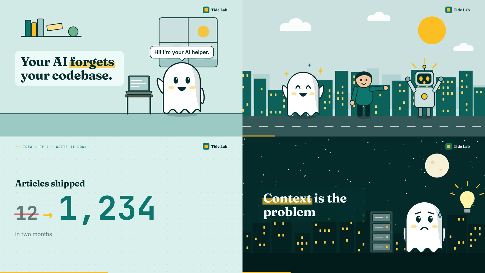

# Faceless YouTube Video Creator

**A Claude Code skill that makes the whole faceless YouTube video, on your machine:** topic, script, AI voiceover, animated slides with illustrated scenes, subtitles, chapters, title, description and two A/B thumbnails. You type "make a YouTube video about how tokens work" and get an MP4 you can upload.

Built and used by [Zentesimal](https://zentesimal.com/?utm_source=github&utm_medium=oss&utm_campaign=faceless-youtube-video-creator-skill) for our own channel. Free and MIT-licensed.



## Quickstart

1. **Install the skill** in Claude Code:

   ```
   /plugin marketplace add zentesimal/faceless-youtube-video-creator-skill
   /plugin install faceless-youtube-video-creator@zentesimal-skills
   ```

   Or copy `skills/faceless-youtube-video-creator/` into your project's `.claude/skills/` (or `~/.claude/skills/` for every project).

2. **Install the tools it renders with** (once): Node 18+, Python 3.10+, `ffmpeg` (`brew install ffmpeg` · `sudo apt install ffmpeg` · `winget install ffmpeg`). The skill installs Playwright and the free voice model on first use.

3. **Ask for a video** in an empty folder:

   ```
   Make a YouTube video about why AI models make things up
   ```

   Each video starts with four questions: the topic (type one, or pick from your topic sheet), the length (8–20 minutes), the language (English or Spanish for now), and whether to research it first. The first time, it also asks four questions (channel name, what the channel is about, the look, extras) and saves them in `faceless-youtube.config.json`. Then it picks the angle with you, writes the script, renders, and hands you the files.

## What you get

For each video, in `videos/<date>-<slug>/`:

- `out/video.mp4`: 1920×1080, 8–20 minutes (you choose), AI voiceover over slides, loudness-normalised.
- `out/video.srt` and `out/chapters.txt`: subtitles and **real** chapter times for the description.
- `youtube.md`: three title options, the description, tags, a pinned comment and the end-screen plan.
- `thumbs/thumb-A.png`, `thumbs/thumb-B.png`: two thumbnails that test one hypothesis, for YouTube's Test & compare.
- `script.md`, `brief.md`: the script (with every slide cue) and the research behind it, with sources.

## What it does

- **Topics with evidence**: from your idea, a keyword or search-query CSV, audience notes, or a topic sheet it keeps for you (`youtube-topics.csv`: ideas, statuses, links and 30-day results). It starts from three example rows (growing flowers, what Zentesimal does, peeling potatoes) that you replace with your own.
- **Research you can check**: optionally, before any script, it researches the topic and shows you the findings with a numbered source list (title, link, dates, primary or secondary); you approve, dig deeper or change the angle. The sources end up in the video's description.
- **A script that holds attention**: hook, intro, 2–5 ideas (as many as the length holds) with proof on screen, a mid-video subscribe ask, summary, outro; a checker flags missing parts and wrong lengths.
- **Free local voiceover**: Kokoro voices (English and Spanish), no API key; it keeps talking (no dead air between slides), with a short beat after the lines that need to land.
- **Slides that move**: pace 1–5, headlines that rise, lists that build, numbers that count up, doodles that draw themselves. Animations are optional.
- **Characters and scenes**: a mascot, people and a robot in 9 poses with speech bubbles, 8 backgrounds and props, all drawn in your colours. Free and offline.
- **Thumbnails in styles common on the home feed**: a big outlined question, a documentary title, a moody one-liner or a question card, over the same scenes as the slides.
- **Your look**: your palette, fonts and logo (`clean`), a hand-drawn MS Paint look (`paint-explainer`), or a new look built from a folder of images you like.
- **Optional generated illustrations** with the OpenAI Image API, in your look's style.
- **Upload-ready metadata**: `youtube.json` with the title, description (chapters included), tags, category and disclosure answers to paste into YouTube Studio, checked against YouTube's limits.
- **Never uploads anything.** You review and publish.

## Configuration

`faceless-youtube.config.json` in your project (created by the first run; full example: [`references/faceless-youtube.config.example.json`](skills/faceless-youtube-video-creator/references/faceless-youtube.config.example.json)).

| Key                                                          | Default                                            | What it sets                                                                  |
| ------------------------------------------------------------ | -------------------------------------------------- | ----------------------------------------------------------------------------- |
| `identity.name`, `identity.handle`                           | `My Channel`                                       | the wordmark, the Subscribe slide, the description footer                     |
| `identity.promise`, `audience`, `pillars`                    | —                                                  | what topics fit and how the channel lines sound                               |
| `look.preset`                                                | `clean`                                            | the default look (`clean`, `paint-explainer`, or your own in `styles/`)       |
| `look.colors`, `look.fonts`, `look.logo`                     | neutral blue/amber, Fraunces + Inter, none         | your brand on every slide and thumbnail                                       |
| `look.mascot`                                                | `ghost`                                            | the default character in scenes (`ghost`, `person`, `robot`)                  |
| `video.minutes`, `pace`, `voice`, `animate`, `illustrations` | `15`, `3`, `af_heart`, `auto`, `false`             | defaults for each video (asked again per video; length 8–20 min)              |
| `paths.workspace`, `topics`, `channel`                       | `./videos`, `./youtube-topics.csv`, `./channel.md` | where things live                                                             |
| `models.image`                                               | `gpt-image-2.5-sunburst`                           | the image model for generated illustrations                                   |
| `credit`                                                     | `true`                                             | the one-line credit at the end of generated descriptions (`false` removes it) |
| `integrations.zentesimal`                                    | `false`                                            | topics from your customers' real questions (below)                            |

Per video, `videos/<…>/style.json` overrides the length, look, pace, voice and extras.

## Requirements

- Node 18+, Python 3.10+, `ffmpeg`, and Chrome or Playwright's Chromium.
- Disk: ~120 MB for the voice model (cached in `videos/.tts/`), ~2 MB per video minute.
- Network, only for: `npm`/PyPI/github.com on first setup (Playwright, kokoro-onnx, the voice model), `api.openai.com` if you turn on generated illustrations, and web searches the agent makes to check facts. Nothing else; no telemetry.
- Optional: `OPENAI_API_KEY` (environment or your project's `.env`) for generated illustrations.

## Built by Zentesimal

[Zentesimal](https://zentesimal.com/?utm_source=github&utm_medium=oss&utm_campaign=faceless-youtube-video-creator-skill) builds AI agents that answer and resolve customer support tickets. We made this skill to run our own YouTube channel, and we open-sourced it because making a good explainer video shouldn't need a studio.

What in this repo points back to us, and how to turn it off:

- **The credit line** at the end of each generated description: set `"credit": false`.
- **The ghost** is our mascot: the default character in scenes (set `look.mascot` to `person` or `robot`) and on thumbnails (set `"mascot": "none"` in a thumbnail spec, or use your own `photo`).
- **Topics from your customers**: if you use Zentesimal, set `"integrations": { "zentesimal": true }` and connect the Zentesimal MCP connector. The skill then pulls the questions your customers actually ask (Voice of Customer, Internal Q&A) as video topics, and drafts your channel setup from your company knowledge. Off by default; everything else works without it.
- [`examples/zentesimal.config.json`](examples/zentesimal.config.json) is the config we use for our channel.

**When this isn't enough:** if the questions your videos answer keep arriving as support tickets, that's what a Zentesimal Play handles: an AI agent that answers them in your helpdesk, with your knowledge.

## License

MIT for the code and docs ([`LICENSE`](LICENSE)). Bundled fonts and the YouTube icon keep their own licences ([`THIRD_PARTY.md`](THIRD_PARTY.md)). The Zentesimal name and logo are trademarks of Zentesimal and aren't covered by the MIT licence.
