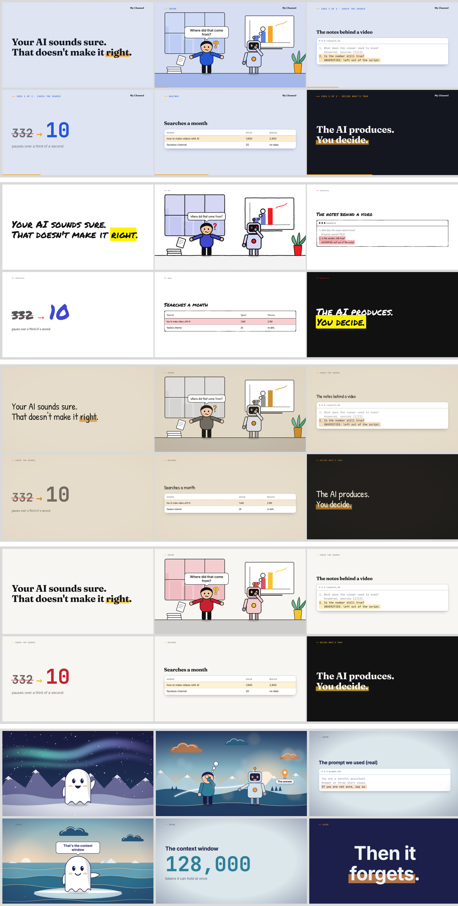

# Faceless YouTube Video Creator

**A Claude Code skill that makes the whole faceless YouTube video, on your machine:** topic, script, AI voiceover, animated slides with illustrated scenes, subtitles, chapters, title, description and two A/B thumbnails. You type "make a YouTube video about how tokens work" and get an MP4 you can upload.

Built and used by [Zentesimal](https://zentesimal.com/?utm_source=github&utm_medium=oss&utm_campaign=faceless-youtube-video-creator-skill) for our own channel. Free and MIT-licensed.


## Quickstart

1. **Install the skill** in Claude Code:

   ```
   /plugin marketplace add zentesimal/faceless-youtube-video-creator-skill
   /plugin install faceless-youtube-video-creator@zentesimal-skills
   ```

   Or copy `skills/faceless-youtube-video-creator/` into your project's `.claude/skills/` (or `~/.claude/skills/` for every project).

2. **Install the tools it renders with** (once): Node 18+, Python 3.10+, `ffmpeg` (`brew install ffmpeg` · `sudo apt install ffmpeg` · `winget install ffmpeg`). The skill installs Playwright and the free voice model on first use.

3. **Ask for a video** in an empty folder:

   ```
   Make a YouTube video about why AI models make things up
   ```

   The first time, it asks four questions (channel name, what the channel is about, the look, extras) and saves them in `faceless-youtube.config.json`. Every video then starts with the same short setup: how technical your viewer is (or whether they're developers), the topic (type one, or pick from your topic sheet), the length (8–20 minutes), the language (English or Spanish for now) and whether to research it first; then free or OpenAI (the free local voice and vector scenes, or an OpenAI voice that acts the script plus generated illustrations; your key goes in the folder's `.env`), the look, the pace, the voice (with samples) and animations. Then it picks the angle with you, writes the script, renders, and hands you the files.

## What you get

For each video, in `videos/<date>-<slug>/`:

- `out/video.mp4`: 1920×1080, 8–20 minutes (you choose), AI voiceover over slides, loudness-normalised.
- `out/video.srt` and `out/chapters.txt`: subtitles and **real** chapter times for the description.
- `youtube.md`: three title options, the description, tags, a pinned comment and the end-screen plan.
- `thumbs/thumb-A.png`, `thumbs/thumb-B.png`: two thumbnails that test one hypothesis, for YouTube's Test & compare. You review them before delivery, and the skill re-renders from your feedback until you approve both.
- `shorts/<n>-<slug>/out/short.mp4` (when you ask, once the video is approved): three vertical Shorts, 30–55 s, in the same look and voice, with burned-in captions, each with its `cover/cover.png` (a 1080×1920 cover image to upload with it).
- `script.md`, `brief.md`: the script (with every slide cue) and the research behind it, with sources.

## What it does

- **Topics with evidence**: from your idea, a keyword or search-query CSV, audience notes, or a topic sheet it keeps for you (`youtube-topics.csv`: ideas, statuses, links and 30-day results). It starts from three example rows (growing flowers, what Zentesimal does, peeling potatoes) that you replace with your own.
- **Research you can check**: optionally, before any script, it researches the topic and shows you the findings with a numbered source list (title, link, dates, primary or secondary); you approve, dig deeper or change the angle. The sources end up in the video's description.
- **A script that holds attention**: hook, intro, 2–5 ideas (as many as the length holds) with proof on screen, a mid-video subscribe ask, summary, outro; a checker flags missing parts and wrong lengths.
- **Free local voiceover**: Kokoro voices (English and Spanish), no API key, or optionally a paid OpenAI voice or an ElevenLabs voice from your own library (sampled before you pick, `eleven_v4` by default) with your own key; it keeps talking (no dead air between slides), with a short beat after the lines that need to land.
- **A voice with emotion**: every script gets an emotional arc (a hook that builds intrigue and suspense, a surprise on each idea's reveal, a serious catch, a warm goodbye), marked line by line with `> TONE` cues. Every voice gets the timing (a held breath before the reveal, slower suspense, quicker wins); OpenAI and ElevenLabs voices act it too. The checker warns about a flat read or over-acting; `"expressive"` in `style.json` turns it up or down.
- **Slides that move**: pace 1–5, headlines that rise, lists that build, numbers that count up, doodles that draw themselves. Animations are optional.
- **Characters and scenes**: a mascot, people and a robot in 9 poses with speech bubbles, 8 backgrounds and props, all drawn in your colours. Free and offline.
- **Thumbnails that state a direct claim**: each headline says what the video proves ("IT CAN'T COUNT"), not a topic label or a vague teaser, and the renderer warns when one slips in.
- **Thumbnails in styles common on the home feed**: a big outlined question, a documentary title, a moody one-liner or a question card, over the same scenes as the slides.
- **Your look**: your palette, fonts and logo (`clean`), a hand-drawn MS Paint look (`paint-explainer`), pencil-and-ink sketches on warm paper (`sketch-explainer`), a data-first magazine look (`editorial`), an animated flat-vector world with a moving camera, particles and map pins (`illustrated-explainer`), or a new look built from a folder of images you like. See [Looks](#looks).
- **Asks before it writes**: every video starts with the same short questions (viewer level, topic, length, language, research; then free or OpenAI, the look from the `styles/` folder with previews, the pace, the voice with samples and animations), and the checker won't pass a script until the answers are saved.
- **Made for your viewer**: it asks first how technical your viewer is (0–5) and writes to that level: plain words and everyday comparisons for newcomers, the precise vocabulary and a deeper dive for experts. Processes and loops become animated `flow` diagrams that build with the voice.
- **Optional generated illustrations** with the OpenAI Image API, in your look's style.
- **Story teller mode**: a generated illustration for every sentence, so the picture follows the voice like a picture book read aloud, with a camera move on each picture and a dissolve between them. Describe your recurring characters once and they look the same in every picture. About 100 pictures for an 8-minute video (billed by OpenAI; the skill gives you the exact count before anything is spent).
- **Product screens, animated like a demo**: list the screens an idea needs (a public page, your app behind a login, an image from your docs) and `capture-screens.mjs` captures them with Playwright, before and after a click, recording where each button is. On screen they sit in a browser, window or phone frame in your look, and the camera zooms into the option the voice names, spotlights it, a cursor clicks it and the real result fades in. Emails and phone numbers are blurred and your own redaction rules applied before every picture. When a real shot isn't possible, a `mock` recreates the UI in your look's style, always labelled "Recreated from …" on screen.
- **A channel kit**: one `channel/` folder with your channel brief, logo, avatar and the description, keywords and upload defaults to paste into YouTube Studio.
- **Upload-ready metadata**: `youtube.json` with the title, description (chapters included), tags, category and disclosure answers to paste into YouTube Studio, checked against YouTube's limits.
- **Shorts from every video**: it proposes five moments that stand on their own, you pick three, and each is rewritten as a 30–55 s Short (hook, payoff, a line that loops) and rendered vertically with big captions, ready to link to the long video. Each Short also gets a cover image: two designs on different angles, you pick the one that ships.
- **Never uploads anything.** You review and publish.

## Configuration

`faceless-youtube.config.json` in your project (created by the first run; full example: [`references/faceless-youtube.config.example.json`](skills/faceless-youtube-video-creator/references/faceless-youtube.config.example.json)).

| Key                                                          | Default                                                                 | What it sets                                                                                                                         |
| ------------------------------------------------------------ | ----------------------------------------------------------------------- | ------------------------------------------------------------------------------------------------------------------------------------ |
| `identity.name`, `identity.handle`                           | `My Channel`                                                            | the wordmark, the Subscribe slide, the description footer                                                                            |
| `identity.promise`, `audience`, `pillars`                    | —                                                                       | what topics fit and how the channel lines sound                                                                                      |
| `look.preset`                                                | `clean`                                                                 | the default look (`clean`, `paint-explainer`, `sketch-explainer`, `editorial`, `illustrated-explainer`, or your own in `styles/`)    |
| `look.colors`, `look.fonts`, `look.logo`                     | neutral blue/amber, Fraunces + Inter, `channel/logo.*`                  | your brand on every slide and thumbnail                                                                                              |
| `look.mascot`                                                | `ghost`                                                                 | the default character in scenes (`ghost`, `person`, `robot`)                                                                         |
| `video.minutes`, `pace`, `voice`, `animate`, `illustrations` | `15`, `3`, `af_heart`, `auto`, `false`                                  | defaults for each video (asked again per video; length 8–20 min)                                                                     |
| `paths.workspace`, `topics`, `kit`, `channel`                | `./videos`, `./youtube-topics.csv`, `./channel`, `./channel/channel.md` | where things live                                                                                                                    |
| `models.image`                                               | `gpt-image-2.5-sunburst`                                                | the image model for generated illustrations                                                                                          |
| `screens.redact`                                             | `[]`                                                                    | redactions before every product screenshot (e.g. `{"host": "app.example.com", "selector": ".account-name", "text": "Demo Account"}`) |
| `credit`                                                     | `true`                                                                  | the one-line credit at the end of generated descriptions (`false` removes it)                                                        |
| `integrations.zentesimal`                                    | `false`                                                                 | topics from your customers' real questions (below)                                                                                   |

Per video, `videos/<…>/style.json` overrides the length, look, pace, voice and extras.

## Your channel kit

Everything about your channel lives in one folder, written by the first run and read by every video:

```
channel/
├── channel.md           # the brief: name, handle, promise, audience, pillars, channel lines, subscribe asks, description footer
├── logo.png             # your logo on slides and thumbnails (used when the config's look.logo is empty)
├── avatar.png           # your profile picture, also on the Subscribe slide (used when identity.avatar is empty)
├── banner.png           # optional: your channel banner, 2560×1440
├── watermark.png        # optional: the video watermark, 150×150
└── youtube-settings.md  # what to paste in YouTube Studio: description, keywords, links, upload defaults
```

Templates: [`references/channel.example.md`](skills/faceless-youtube-video-creator/references/channel.example.md) and [`references/youtube-settings.example.md`](skills/faceless-youtube-video-creator/references/youtube-settings.example.md). An older project with `channel.md` at its root keeps working.

## Working from a clone

If you cloned this repo and run Claude Code inside it, your own files live next to the skill and stay out of git (see [`.gitignore`](.gitignore)), so `git pull` brings updates without conflicts and `git status` stays clean. The first run writes them for you; to set them up by hand, copy the samples:

```bash
R=skills/faceless-youtube-video-creator/references
cp $R/faceless-youtube.config.example.json faceless-youtube.config.json   # brand, look, voice, paths
mkdir -p channel
cp $R/channel.example.md channel/channel.md                               # name, promise, pillars, channel lines
cp $R/youtube-settings.example.md channel/youtube-settings.md             # what to paste in YouTube Studio
cp $R/youtube-topics.example.csv youtube-topics.csv                       # your topic sheet
cp $R/env.example .env                                                    # only for the paid voices / images
```

Then drop your `logo.png` and `avatar.png` into `channel/` and edit the copies.

| Ignored                        | What it is                                                         |
| ------------------------------ | ------------------------------------------------------------------ |
| `faceless-youtube.config.json` | your channel's config: identity, brand colours and fonts, defaults |
| `channel/`                     | your channel kit (brief, logo, avatar, banner, YouTube settings)   |
| `youtube-topics.csv`           | your topic sheet                                                   |
| `videos/`                      | every video's workspace: scripts, renders, thumbnails              |
| `.env`, `.env.*`               | your API keys                                                      |
| `skills/*/styles/my-*/`        | your own looks: name a new preset `my-<name>` and it stays private |
| `*.local.*`                    | any other personal file, e.g. `notes.local.md`                     |

Never edit the files in `references/` or a shipped look in `styles/` for your channel: copy them first (a look to `styles/my-<name>/`). Edits there are what `git pull` would conflict with.

## Looks



From top to bottom: `clean`, `paint-explainer`, `sketch-explainer`, `editorial`, `illustrated-explainer`. Each folder in [`styles/`](skills/faceless-youtube-video-creator/styles/README.md) has its own `preview.png`. The previews use the free vector scenes (stills: the `illustrated-explainer` worlds also move, with a camera, particles and map marks). With generated illustrations on, `sketch-explainer` and `illustrated-explainer` pictures follow their own image style.

## Requirements

### Required

| What                              | Why                                                                                                                          | Install / check                                                                            |
| --------------------------------- | ---------------------------------------------------------------------------------------------------------------------------- | ------------------------------------------------------------------------------------------ |
| Claude Code                       | runs the skill                                                                                                               | https://claude.com/claude-code                                                             |
| Node 18+                          | every script                                                                                                                 | `node -v`                                                                                  |
| Playwright + Chromium (or Chrome) | renders slides and thumbnails                                                                                                | `npm install --prefix <skill folder>`, then `npx playwright install chromium` if no Chrome |
| Python 3.10+ with `venv`          | the free Kokoro voice runs in its own virtualenv                                                                             | `python3 --version`                                                                        |
| `ffmpeg` (with `ffprobe`)         | encodes the video, checks durations                                                                                          | `brew install ffmpeg` · `sudo apt install ffmpeg` · `winget install ffmpeg`                |
| Network on the first run          | npm, PyPI and github.com: Playwright, kokoro-onnx, the voice model (~120 MB)                                                 | once; cached in `videos/.tts/`                                                             |
| Disk                              | ~300 MB for the voice setup; ~150 MB per 15-minute video while rendering (clips are cached); the final MP4 is ~2 MB a minute | —                                                                                          |

No YouTube account, API key or login: the skill never talks to YouTube. No telemetry.

### Optional

| What                                                                                                                               | Turns on                                                                                   | Notes                                                                                                                                                                                                                                                                                |
| ---------------------------------------------------------------------------------------------------------------------------------- | ------------------------------------------------------------------------------------------ | ------------------------------------------------------------------------------------------------------------------------------------------------------------------------------------------------------------------------------------------------------------------------------------ |
| `OPENAI_API_KEY` (environment or your project's `.env`) + access to `api.openai.com`                                               | generated illustrations and scene backgrounds                                              | each picture is a billed OpenAI Image API call; `sketch-explainer` looks best with them. Without a key, scenes stay free and offline                                                                                                                                                 |
| `OPENAI_API_KEY` or `ELEVENLABS_API_KEY` (environment or your project's `.env`) + access to `api.openai.com` / `api.elevenlabs.io` | paid voices: `"voice": "openai:coral"` or `"elevenlabs:<voice id>"`                        | billed per line by the provider, each line bought once (cached). They act the script's tones (suspense, surprise…); Kokoro, the free default, only times them. Put the keys in your project's `.env` (template: `references/env.example`) and test them with `providers.mjs --check` |
| Web search and page access in Claude Code                                                                                          | the research step: facts with a numbered, checkable source list                            | pages your network blocks can't be cited; those facts are flagged instead                                                                                                                                                                                                            |
| A transcript or SEO connector (any)                                                                                                | reading a reference video's transcript for a new look; search volumes for your topic sheet | optional; the skill works from your own CSVs without it                                                                                                                                                                                                                              |
| A signed-in browser session (`capture-screens.mjs --login <name> <url>`, once)                                                     | product screens from apps behind a login                                                   | saved in `<workspace>/.auth/` (a live login: keep the workspace out of git). Public pages need no login                                                                                                                                                                              |
| Zentesimal connector                                                                                                               | topics from your customers' real questions                                                 | see below                                                                                                                                                                                                                                                                            |

## Built by Zentesimal

[Zentesimal](https://zentesimal.com/?utm_source=github&utm_medium=oss&utm_campaign=faceless-youtube-video-creator-skill) builds AI agents that answer and resolve customer support tickets. We made this skill to run our own YouTube channel, and we open-sourced it because making a good explainer video shouldn't need a studio.

What in this repo points back to us, and how to turn it off:

- **The credit line** at the end of each generated description: set `"credit": false`.
- **The ghost** is our mascot: the default character in scenes (set `look.mascot` to `person` or `robot`) and on thumbnails (set `"mascot": "none"` in a thumbnail spec, or use your own `photo`).
- **Topics from your customers**: if you use Zentesimal, set `"integrations": { "zentesimal": true }` and connect the Zentesimal MCP connector. The skill then pulls the questions your customers actually ask (Voice of Customer, Internal Q&A) as video topics, and drafts your channel setup from your company knowledge. Off by default; everything else works without it.
- [`examples/zentesimal.config.json`](examples/zentesimal.config.json) is the config we use for our channel.

**When this isn't enough:** if the questions your videos answer keep arriving as support tickets, that's what a Zentesimal Play handles: an AI agent that answers them in your helpdesk, with your knowledge.

## License

MIT for the code and docs ([`LICENSE`](LICENSE)). Bundled fonts and the YouTube icon keep their own licences ([`THIRD_PARTY.md`](THIRD_PARTY.md)). The Zentesimal name and logo are trademarks of Zentesimal and aren't covered by the MIT licence.
